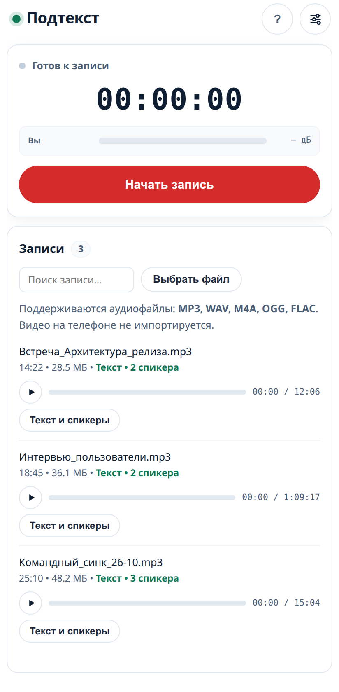
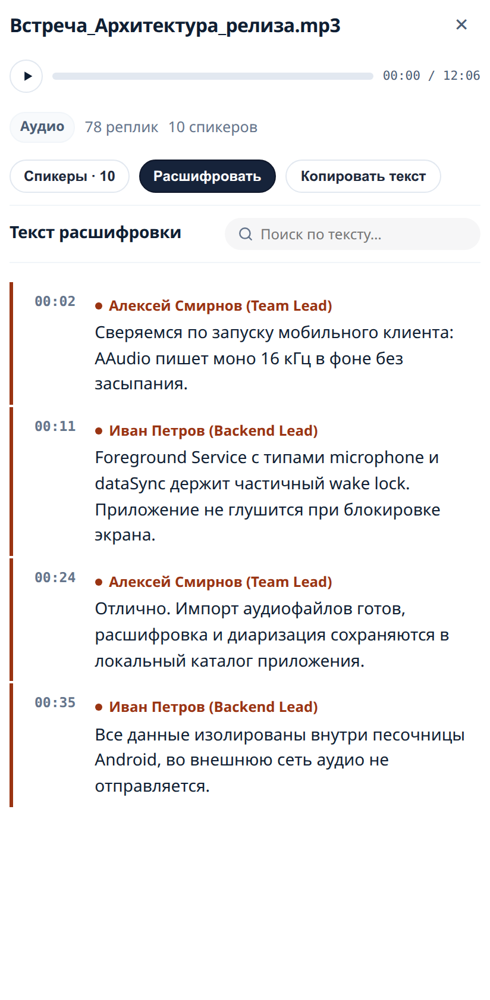
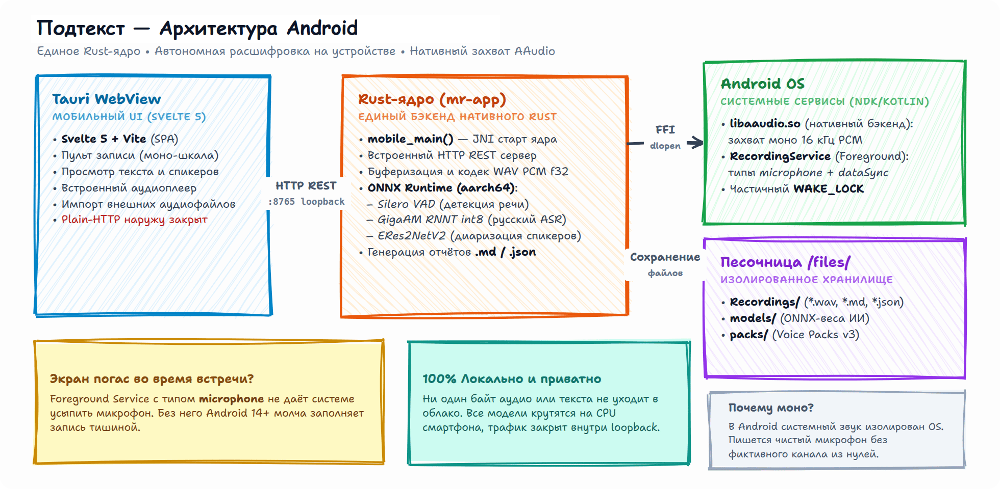

<div align="center">


# Подтекст (Podtekst) для Android

**Автономная запись с микрофона и локальная расшифровка речи на смартфоне.**  
Собрано из единого Rust-ядра: на устройстве работает локальный HTTP-сервер (`127.0.0.1:8765`), нативный AAudio-бэкенд захвата и легковесное WebView Tauri v2.

[-green.svg)](#системные-требования-для-сборки)
[](#сборка-одной-командой)
[](LICENSE)
[](#статус-и-ограничения)

---

<p align="center">
  
  &nbsp;&nbsp;&nbsp;&nbsp;
  
</p>
<p align="center"><em>Адаптивный мобильный интерфейс: пульт записи с моно-шкалой и просмотр реплик спикеров</em></p>

</div>

---

## Возможности мобильной версии

- **Прямой захват через AAudio:** Низкоуровневая работа с системной библиотекой `libaaudio.so` через FFI (`dlopen`). Захват аудиопотока в 16 кГц PCM напрямую без прослоек Java AudioRecord.
- **Работа при выключенном экране:** На Android 14+ система принудительно глушит фоновый микрофон, если приложение не зарегистрировано как системная служба. В Подтекст встроен Foreground Service (`RecordingService.kt`) с типами `microphone` и частичным `WAKE_LOCK`. Запись не прерывается и не заполняется нулями при блокировке экрана.
- **Фоновая расшифровка (`dataSync`):** процесс распознавания и диаризации выполняется в отдельной фоновой службе. Телефон можно заблокировать или свернуть приложение: обработка не остановится по тайм-ауту.
- **Полная изоляция данных:** HTTP-сервер слушает исключительно интерфейс loopback (`127.0.0.1:8765`). Сетевой манифест (`network_security_config.xml`) блокирует передачу открытого трафика во внешнюю сеть. Все записи, модели и отпечатки сохраняются строго в изолированной песочнице приложения.
- **Импорт готовых аудиозаписей:** Поддержка загрузки внешних диктофонных записей (`MP3`, `WAV`, `M4A`, `OGG`, `FLAC`) через системный файловый диалог «Выбрать файл».

---

## Сравнение с десктопной версией

| Функция | Десктоп (Linux / macOS / Windows) | Android (смартфон / планшет) |
| :--- | :---: | :---: |
| **Захват микрофона** | Да (стерео сплит / моно) | Да (нативный AAudio, моно) |
| **Захват звука собеседников (Loopback)** | Да (PipeWire / CoreAudio / WASAPI) | ❌ Нет (ограничение безопасности Android OS) |
| **Запись при блокировке экрана** | Да (фоновый процесс) | Да (Foreground Service + WakeLock) |
| **Импорт аудиофайлов** | Да (любые форматы) | Да (`MP3`, `WAV`, `M4A`, `OGG`, `FLAC`) |
| **Импорт видео и извлечение звука** | Да (через встроенный/системный FFmpeg) | ❌ Отключено (FFmpeg не включается в APK для экономии памяти) |
| **Каталог и скачивание ИИ-моделей** | Да (GigaAM, Whisper, ERes2NetV2) | Да (локальная загрузка в память устройства) |
| **Системный трей и глобальные хоткеи** | Да | ❌ Специфика мобильной ОС |

> [!NOTE]
> **Почему на Android нет захвата системного звука звонков:**  
> В Android системный аудиовыход изолирован политиками безопасности SELinux. Приложения не имеют права слушать звук других программ без запуска системного захвата экрана (`MediaProjection`) с постоянным системным предупреждением о записи экрана. Поэтому на смартфоне приложение работает как классический защищённый диктофон с локальным ИИ.

---

## Сборка одной командой

Скрипт `build-android.sh` автоматически собирает веб-интерфейс (Svelte 5 + Vite), компилирует Rust-ядро под архитектуру `aarch64-linux-android` и упаковывает готовый компактный APK-файл через Gradle:

```bash
# Компактный релизный APK (~32 МБ, подписан ключом, сразу готов к установке на устройство)
./build-android.sh

# Отладочная сборка с тяжелыми символами (~200 МБ) — только при необходимости
DEBUG=1 ./build-android.sh
```

Готовый файл всегда сохраняется по фиксированному пути:
```
dist/podtekst-android.apk
```

### Установка на устройство через ADB

Подключите телефон по USB с включённой «Отладкой по USB» (Developer Options) и выполните:

```bash
~/Android/Sdk/platform-tools/adb install -r dist/podtekst-android.apk
```

---

## Системные требования для сборки

Для первой сборки APK на рабочей машине должны быть установлены:
1. **Android SDK & NDK:** NDK версии r27+ (`$ANDROID_HOME/ndk/...`).
2. **Java Development Kit:** OpenJDK 21 (`export JAVA_HOME=/usr/lib/jvm/java-21-openjdk-amd64`).
3. **Rust Toolchain:** С таргетом Android:
   ```bash
   rustup target add aarch64-linux-android
   ```
4. **Tauri CLI:** Нативный CLI версии 2.x:
   ```bash
   cargo install tauri-cli --version ^2.12 --locked
   ```
5. **Node.js 20+ и Yarn:** Для компиляции фронтенда.

---

## Архитектура мобильного приложения

<div align="center">
  
</div>

### Структура файлов в репозитории

- `src-tauri/crates/mr-app/src/lib.rs` - точка входа `mobile_main()` с аннотацией `#[tauri::mobile_entry_point]`.
- `src-tauri/crates/mr-audio/src/capture/android.rs` - нативный захват микрофона через системный `libaaudio.so`.
- `src-tauri/crates/mr-app/gen/android/` - полнофункциональный Gradle-проект Tauri.
- `src-tauri/crates/mr-app/gen/android/app/src/main/java/.../RecordingService.kt` - сервис фоновой записи и уведомлений.
- `src-tauri/crates/mr-app/gen/android/app/src/main/AndroidManifest.xml` - декларация прав (`RECORD_AUDIO`, `FOREGROUND_SERVICE_MICROPHONE`, `FOREGROUND_SERVICE_DATA_SYNC`, `POST_NOTIFICATIONS`, `WAKE_LOCK`).

### Расположение данных на телефоне

Все данные приложения хранятся во внутреннем изолированном каталоге:
```
/data/data/io.github.guest363.podtekst/files/
├── Recordings/       # Записанные аудиофайлы (*.wav) и конспекты (*.md, *.json)
├── models/           # Скачанные веса ИИ-моделей (Silero, GigaAM, ERes2NetV2)
└── packs/            # Голосовые отпечатки и профили участников
```

---

## Отладка и просмотр логов

Для отслеживания работы Rust-сервера, жизненного цикла сервиса и инициализации аудиоподсистемы используйте `adb logcat`:

```bash
# Логи ядра и WebView
adb logcat -v time | grep -iE 'tauri|mr_app|podtekst|MeetingRecorder'

# Проверка загрузки и работы аудиозахвата AAudio
adb logcat -v time | grep -iE 'AAudio|mr_audio'
```

---

## Диагностика и частые вопросы (FAQ)

### 1. Почему в записи слышна тишина после блокировки экрана?
На прошивках с агрессивным энергосбережением (Xiaomi MIUI/HyperOS, Huawei EMUI, Samsung OneUI) система может принудительно выгружать сетевые сокеты и фоновые процессы.  
**Решение:** Откройте настройки приложения в системе: *Настройки → Приложения → Подтекст → Контроль активности / Батарея* и выберите **«Без ограничений»**.

### 2. Нужно ли постоянное интернет-соединение?
Нет. Интернет требуется только один раз - при скачивании весов модели распознавания непосредственно на смартфон. Сама запись, обработка звука и локальная расшифровка происходят автономно без обращения к облаку.

### 3. Где найти созданные заметки Markdown?
Заметки `.md` и текстовые расшифровки сохраняются рядом с аудиофайлами во внутреннем каталоге приложения. Их можно экспортировать через кнопку «Копировать текст» в интерфейсе просмотра или передать через встроенный системный диалог отправки файлов.

---

## Статус и ограничения

Мобильная сборка находится в статусе **Beta**:
- Захват моно-аудио и долгая запись стабильно протестированы на Android 12, 13 и 14.
- Локальная транскрипция зависит от рантайма `libonnxruntime.so` под архитектуру `aarch64`. На части старых чипсетов без инструкций DotProd/FP16 инференс больших моделей может требовать повышенного времени работы.
