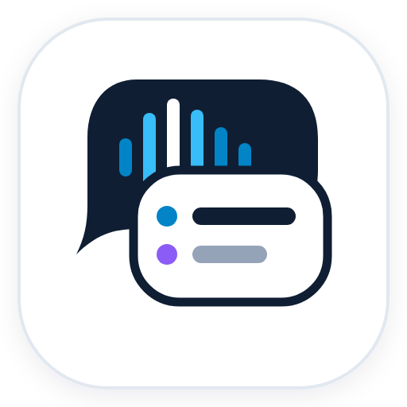
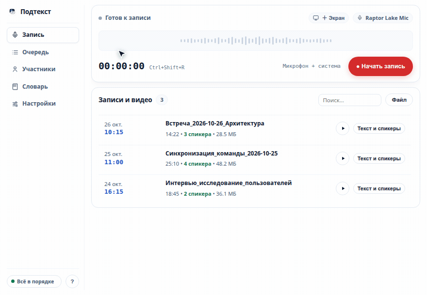
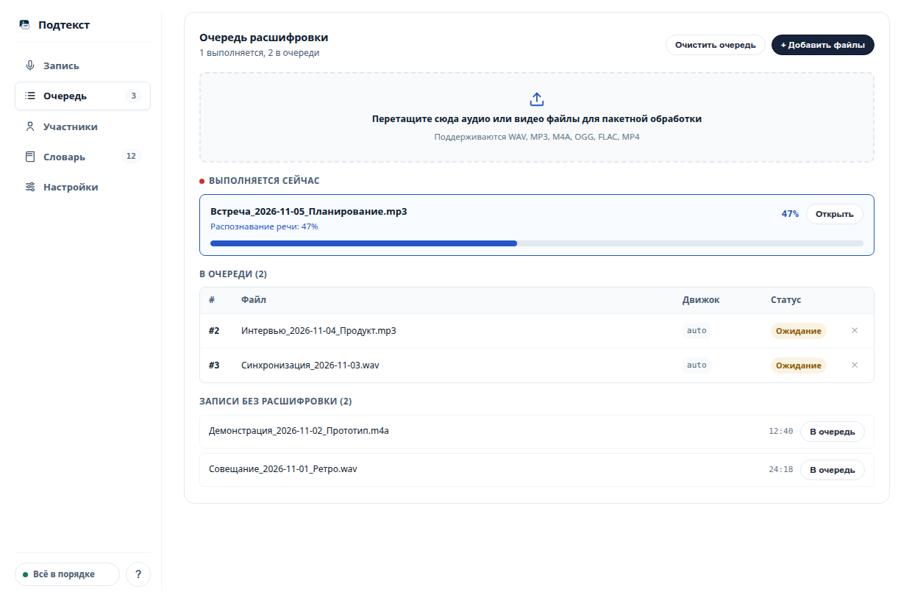
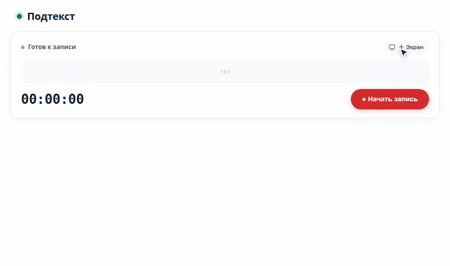
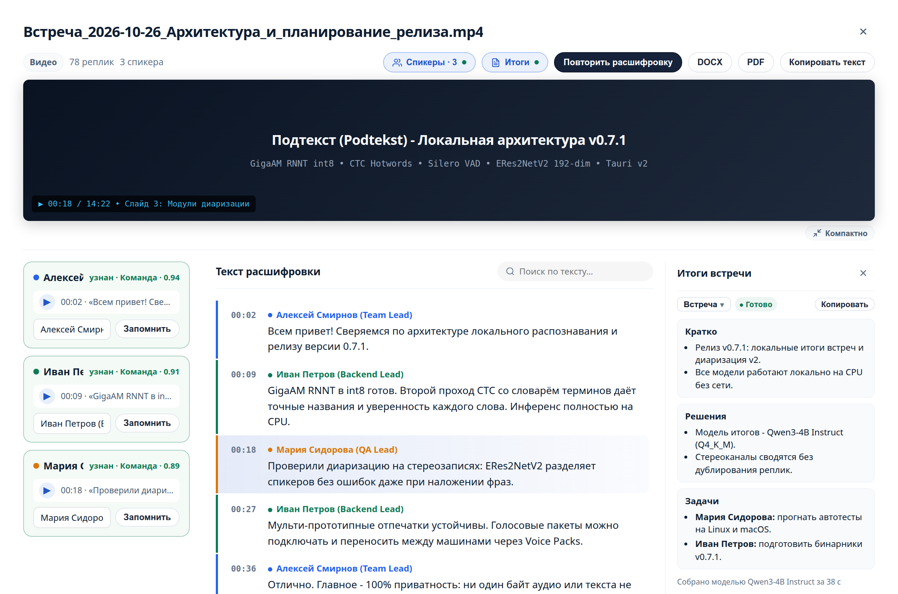
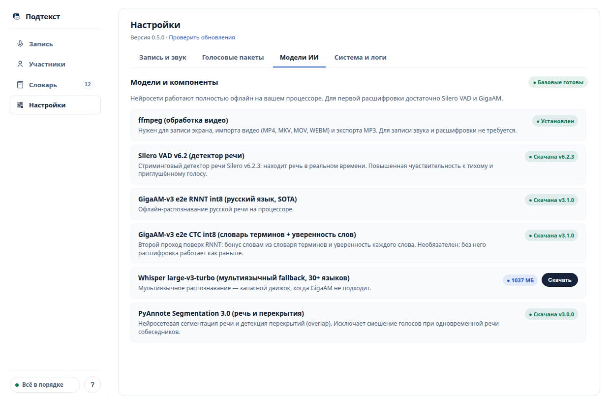

<div align="center">



# Подтекст (Podtekst)

**Локальная запись звонков и расшифровка речи на вашем компьютере.**  
Без облачных сервисов и платных подписок.

[](https://github.com/guest363/podtekst/actions/workflows/ci.yml)
[](https://github.com/guest363/podtekst/releases)
[](rust-toolchain.toml)
[](LICENSE)
[](#поддерживаемые-платформы)

---


<p><em>Запись встречи, раздельный захват собеседников, локальная расшифровка по спикерам и очередь файлов</em></p>

</div>

---

## Ключевые возможности

- **Раздельный захват.** Микрофон пишется в левый канал, системный звук звонка - в правый. Захват работает через PipeWire, PulseAudio, WASAPI Loopback (Windows Audio Session API) и ScreenCaptureKit. Разделение имеет смысл только в наушниках: если звук идёт из колонок, микрофон слышит собеседников, и оба канала несут почти одну и ту же речь. Перед расшифровкой приложение сравнивает каналы и при дубле оставляет микрофон, обрабатывая запись как один канал — так быстрее и без двойных реплик. Речь, слышная только в системном канале, в этом режиме может не попасть в текст; для полного разделения используйте наушники.
- **Полная локальность.** Распознавание идёт на устройстве через ONNX Runtime. Аудио, текст и голосовые отпечатки не отправляются в сеть.
- **Русская речь: GigaAM-v3.** Модель от SberDevices с квантованием INT8 весит 226 МБ. Она работает на процессоре без видеокарты.
- **Словарь терминов и уверенность слов.** Второй проход GigaAM CTC учитывает до 500 профессиональных терминов, имён и сленга. Модель оценивает уверенность каждого слова и исправляет частые ошибки на слух.
- **Очередь расшифровки.** Добавьте несколько файлов перетаскиванием или кнопкой. Приложение расшифрует их по одному и покажет прогресс текущей задачи. Задачу можно снять по одной или очистить очередь целиком.
- **Мультиязычность: Whisper Turbo.** Модель Whisper large-v3-turbo (INT8, около 1,08 ГБ) распознаёт встречи на английском и более чем 30 языках.
- **Диаризация и узнавание коллег.** Модель ERes2NetV2 (3D-Speaker) делит дорожку на реплики и узнаёт знакомые голоса по сохранённым профилям (Voice Packs).
- **Синхронная запись экрана.** Рабочий стол или окно звонка записываются вместе с микрофоном и системным звуком. Видео и звук сохраняются в один MP4-файл. Захват работает на Linux (GNOME Shell / PipeWire), Windows (ffmpeg gdigrab) и macOS (ffmpeg avfoundation). ffmpeg ставится кнопкой из интерфейса. Встроенный плеер синхронизирует видео с репликами и таймкодами.
- **Готовые конспекты для базы знаний.** После остановки записи приложение создаёт рядом с файлом:
  - `.md` - протокол со спикерами и таймкодами для Obsidian, Notion или Logseq;
  - `.txt` - чистый текст для локальных языковых моделей;
  - `.transcript.json` - реплики, таймкоды и 192-мерные векторы голосов.

---

<div align="center">
  
  <p><em>Очередь расшифровки: текущая задача, ожидающие файлы и записи без расшифровки</em></p>
</div>

---

<div align="center">
  
  <p><em>Запись экрана: одновременный захват видео, микрофона и системного звука (Linux, Windows, macOS)</em></p>
</div>

---

<div align="center">
  
  <p><em>Интерфейс расшифровки: таймкоды реплик, привязка голосов к участникам и экспорт в Markdown</em></p>
</div>

---

## Поддерживаемые платформы

| Платформа | Живой захват аудио | Запись экрана | Импорт файлов и видео | Статус |
| :--- | :---: | :---: | :---: | :--- |
| **Linux** (PipeWire / PulseAudio) | Да (микрофон + система) | Да (GNOME Shell / PipeWire) | Да | Готов к работе |
| **Windows** (10 / 11, x64) | Да (WASAPI: микрофон + системный звук) | Да (ffmpeg gdigrab; ставится кнопкой из интерфейса) | Да | Готов к работе |
| **macOS** (Apple Silicon, 13.4+) | Да (CoreAudio: микрофон; ScreenCaptureKit: системный звук) | Да (ffmpeg avfoundation) | Да | Тестирование |
| **Android** | Только микрофон | Нет | Аудио (без видео) | Экспериментально (смотрите [ANDROID.md](ANDROID.md)) |

> Готовые бинарные пакеты доступны на вкладке [Releases](https://github.com/guest363/podtekst/releases).

---

## Быстрый старт

### Вариант 1. Готовые сборки
Скачайте исполняемый файл для вашей операционной системы со страницы [Releases](https://github.com/guest363/podtekst/releases):
- **Linux:** `.AppImage`
- **macOS:** `.dmg` (или запуск через `run.command`)
- **Windows:** `.exe` (SmartScreen может предупредить: смотрите [docs/UNSIGNED-INSTALL.md](docs/UNSIGNED-INSTALL.md))

#### macOS: если после установки «невозможно открыть»

Релизы сознательно не подписаны Apple Developer ID и не нотаризованы.
Проверьте контрольную сумму SHA-256 `.dmg` по `SHA256SUMS`, скопируйте приложение в
`/Applications` и один раз снимите карантин:

```bash
xattr -dr com.apple.quarantine /Applications/Podtekst.app
open /Applications/Podtekst.app
```

То же самое можно сделать без терминала: правый клик по приложению →
**«Открыть»** → **«Открыть»** в диалоге. Подробная инструкция для macOS,
Windows и Linux: [docs/UNSIGNED-INSTALL.md](docs/UNSIGNED-INSTALL.md).
Обновления при этом проверяются minisign-подписью ключом проекта.

При первом запуске macOS спросит доступ к микрофону, а при первой записи -
к экрану и системному аудио. Разрешите оба пункта: без второго приложение
не слышит собеседников.

#### macOS: звук собеседников и запись экрана

С версии 0.4.0 системный звук идёт через ScreenCaptureKit: собеседники из
Zoom, Meet или Telegram попадают в правый канал, BlackHole не нужен.
Слушайте встречу в наушниках: при выводе на колонки микрофон записывает
и собеседников, и приложение сводит каналы в один.

1. Запустите запись и разрешите доступ в «Системные настройки» →
   «Конфиденциальность и безопасность» → «Запись экрана и системного аудио».
2. Перезапустите приложение, если macOS попросит.
3. Пока доступа нет, в интерфейсе висит предупреждение «Системный звук:
   нужно разрешение», а запись идёт только с микрофона.

Виртуальный драйвер остаётся запасным вариантом. Если ScreenCaptureKit
недоступен, установите **BlackHole 2ch** (`brew install blackhole-2ch`),
создайте многовыходное устройство в «Настройке Audio-MIDI» и выберите
BlackHole источником системного звука в настройках приложения.

### Вариант 2. Запуск из исходников

```bash
git clone https://github.com/guest363/podtekst.git
cd podtekst
./run.sh
```

Приложение откроется в нативном окне. Для запуска в режиме веб-сервера без системных GUI-зависимостей (WebKit/GTK):

```bash
./run.sh --web
```

Консоль управления доступна в браузере по адресу `http://127.0.0.1:8765`.

### Системные требования

- **Процессор:** любой современный x86_64 или Apple Silicon.
- **macOS на Apple Silicon:** запускайте нативную arm64-сборку. x86_64-бинарник
  под Rosetta работает, но ONNX-расшифровка замедляется в разы; `run.command`
  предупреждает об этом.
- **Оперативная память:** от 1,5 ГБ для GigaAM-v3.
- **Whisper:** от 4 ГБ свободной памяти.
- **Диск:** около 300 МБ для базовых моделей (Silero VAD, GigaAM и 3D-Speaker).
- **С Whisper:** около 1,4 ГБ.
- **Linux:** Ubuntu 22.04+ или glibc 2.35+. Для сборки нативного окна установите библиотеки:
  ```bash
  sudo apt install libwebkit2gtk-4.1-dev libgtk-3-dev libayatana-appindicator3-dev librsvg2-dev libssl-dev libxdo-dev
  ```
- **Форматы:** MP3, WAV, M4A, OGG, Opus, FLAC и MP4 декодируются нативно через Symphonia. Для MKV, WebM, MOV и AVI нужен системный `ffmpeg`.

---

## Локальный ИИ-конвейер

Обработка аудиопотока выполняется на 100% локально через **ONNX Runtime (CPU)** без дискретной видеокарты:

```
Аудиодорожка (16 кГц)
   │
   ▼
[Silero VAD v6] ──────────► Нарезка аудио на речевые фрагменты без пауз и шума
   │
   ├──────────────────────────────┬──────────────────────────────┐
   ▼                              ▼                              ▼
[GigaAM-v3 e2e RNNT]   [Whisper large-v3-turbo]        [ERes2NetV2 3D-Speaker]
(Основной ASR, RU, 226 МБ) (более 30 языков, INT8, 1,08 ГБ) (Голосовые векторы, 68 МБ)
   │                              │                              │
   └───────────────┬──────────────┘                              ▼
                   ▼                                  Венгерская кластеризация
            Текст реплик ───────────────────────────► Итоговый Markdown / JSON
```

### Характеристики используемых моделей

| Модель | Назначение | Архитектура и веса | Память (RAM) | Особенности | Лицензия |
| :--- | :--- | :--- | :---: | :--- | :---: |
| **GigaAM-v3 e2e RNNT** | Основной ASR (RU) | Conformer-Transducer, 242 млн параметров, **INT8** (226 МБ) | ~600 МБ | Лучшее качество для русской речи, жадный RNNT-декодинг | MIT |
| **GigaAM-v3 e2e CTC** | Словарь терминов и уверенность слов | Conformer-CTC, 242 млн параметров, **INT8** (225 МБ) | ~600 МБ | Второй проход: точность профессиональной лексики, подсказки на слух и оценка уверенности слов | MIT |
| **Whisper Turbo** | Мультиязычный ASR | Seq2Seq Transformer, **INT8** (1,08 ГБ) | ~3,8 ГБ | Более 30 языков, сжатый 4-слойный декодер | MIT |
| **Silero VAD v6.2** | Детектор речи | Потоковая рекуррентная сеть (2,3 МБ) | ~15 МБ | Окно 32 мс, фильтрация вздохов, кликов и эха | MIT |
| **ERes2NetV2 3D-Speaker** | Отпечатки голоса | ERes2NetV2, 17,9 млн параметров, FP32 (68 МБ) | ~120 МБ | 192-мерные L2-векторы, точность на отрезках от 1,5 с | Apache-2.0 |

<div align="center">
  
  <p><em>Настройки → Модели ИИ: менеджер моделей с проверкой SHA-256 и докачкой при обрыве; там же ставится ffmpeg</em></p>
</div>

<details>
<summary><strong>Подробнее об обновлении моделей и голосовых пакетах</strong></summary>

1. **Манифест моделей (`models-manifest.json`):** Версии файлов, официальные зеркала (HuggingFace / ModelScope) и контрольные суммы SHA-256 зафиксированы в коде приложения. При скачивании файл пишется во временный `.part` и подменяется атомарно только после совпадения контрольной суммы.
2. **Голосовые пакеты (Voice Packs):** Базы контактов и биометрических профилей хранятся независимо от кода в `<app_data>/packs/<id>/` (`people.json`, `voiceprints.json` v3, `snippets/*.wav`). Их можно экспортировать в `.voicepack.zip` и передавать коллегам.
3. **Совместимость версий (`embedding_space`):** При изменении архитектуры модели эмбеддингов старые несовместимые профили архивируются в резервную копию, предотвращая ошибки кластеризации.
</details>

---

## Управление и горячие клавиши

Глобальный хоткей (работает из любого окна):  
**`Ctrl+Shift+R`** (на macOS - **`Cmd+Shift+R`**) - начать или остановить запись.

### Команды командной строки и автоматизация

```bash
./run.sh --toggle      # Переключить запись (удобно для привязки к системному хоткею)
./run.sh --start       # Начать запись
./run.sh --stop        # Остановить запись
./run.sh --tray        # Фоновый режим в системном трее
./run.sh --web         # Открыть веб-интерфейс в браузере
./run.sh --diagnostics # Собрать отчёт диагностики и напечатать путь к zip

# Пакетная расшифровка аудиофайла без запуска интерфейса:
./run.sh --transcribe meeting.mp3 [--engine auto|gigaam|whisper]
```

---

## Приватность и безопасность

- **Локальная обработка без отправки данных:** все нейросети работают строго локально на вашем процессоре.
- **Отсутствие телеметрии:** приложение не собирает аналитику, логи использования или списки участников.
- **Сетевой трафик идёт только в двух случаях:**
  1. **Загрузка моделей.** Открытые веса скачиваются с официальных репозиториев авторов (HuggingFace, ModelScope) по команде пользователя.
  2. **Проверка обновлений.** При запуске приложение проверяет версию на GitHub. Обновление (Linux: AppImage, macOS: `.app`, Windows: NSIS) запускается только по кнопке. Пакет проверяется minisign-подписью ключом проекта. Без согласия пользователя ничего не устанавливается.

> **Внимание:** соблюдайте законы о конфиденциальности и предупреждайте собеседников о ведении записи разговора. Подробнее - в [PRIVACY.md](PRIVACY.md).

---

## Разработка и участие

Стек: **Rust** (MSRV 1.92, Tokio, Symphonia, Ort) + **Tauri v2** + **Svelte 5** (Vite, TypeScript).

```bash
# Запуск тестов ядра и математики диаризации
cargo test --workspace --locked --manifest-path src-tauri/Cargo.toml

# Проверка кода линтером (строгий режим без предупреждений)
cargo clippy --workspace --all-targets --locked --manifest-path src-tauri/Cargo.toml -- -D warnings

# Проверка типов и сборка фронтенда
cd ui/web/frontend && yarn install --immutable && yarn lint && yarn check && yarn build
```

Подробное описание архитектуры, внутренних крейтов и правил разработки находится в [AGENTS.md](AGENTS.md). Правила участия в разработке - в [CONTRIBUTING.md](CONTRIBUTING.md), там же установка lefthook: те же проверки запускаются перед `git push`.

---

## Документация и ссылки

- [ROADMAP.md](ROADMAP.md) - планы развития и будущие возможности;
- [ANDROID.md](ANDROID.md) - сборка и ограничения мобильной версии;
- [docs/UNSIGNED-INSTALL.md](docs/UNSIGNED-INSTALL.md) - установка сборок без подписи Apple/Microsoft;
- [docs/RELEASING.md](docs/RELEASING.md) - релизный цикл и публикация версий;
- [PRIVACY.md](PRIVACY.md) - политика конфиденциальности и локальности данных;
- [SECURITY.md](SECURITY.md) - сообщение об уязвимостях;
- [LICENSE](LICENSE) - лицензия MIT;
- [THIRD_PARTY_LICENSES.md](THIRD_PARTY_LICENSES.md) - лицензии сторонних библиотек и компонентов.

---

## Стоя на плечах великих

Наше приложение работает локально и без подписок только благодаря исследователям и инженерам, открывшим свои модели и код миру. Мы искренне благодарны авторам проектов и библиотек:

### Модели и исследования
- [GigaAM](https://github.com/salute-developers/GigaAM) (SaluteDevices / Sber AI) - за открытые веса и качественное распознавание русской речи, работающее быстро даже на процессоре ноутбука.
- [Whisper](https://github.com/openai/whisper) (OpenAI) - за мультиязычную архитектуру, позволяющую расшифровывать встречи на десятках языков без отправки звука на чужие серверы.
- [Silero VAD](https://github.com/snakers4/silero-vad) (Silero Team / Александр Вейсов) - за быстрый детектор речи, который отсекает паузы и бережёт ресурсы компьютера.
- [3D-Speaker & ERes2NetV2](https://github.com/alibaba-damo-academy/3D-Speaker) (Alibaba Tongyi Speech Lab / ModelScope) - за качественные модели голосовых отпечатков, позволяющие разделять и узнавать собеседников.
- [ONNX Runtime](https://onnxruntime.ai/) (Microsoft) - за производительный движок, выжимающий максимум скорости из обычного процессора.

### Библиотеки Rust
- [ort](https://github.com/pykeio/ort) - за надёжные привязки к ONNX Runtime, открывшие путь нейросетям в безопасный код на Rust.
- [symphonia](https://github.com/pdeljanov/Symphonia) - за декодер звука на чистом Rust, избавивший проект от громоздких C-зависимостей FFmpeg.
- [hound](https://github.com/ruuda/hound) - за простую и стабильную работу со звуком формата WAV.
- [opus-decoder](https://github.com/shogo4204/opus-decoder) - за прямое чтение голосовых заметок из Telegram и других мессенджеров.

### Платформа и интерфейс
- [Tauri](https://tauri.app/) - за легковесную архитектуру без оверхеда Electron, благодаря которой бинарник весит считанные мегабайты.
- [Svelte](https://svelte.dev/) - за отзывчивый интерфейс без виртуального DOM и удовольствие от разработки.

---

## Поддержка проекта

Разработка проекта ведётся на энтузиазме. Если приложение экономит ваше рабочее время:

- [Поддержать автора чаевыми](https://tips.tips/000490393) (СБП / банковские карты)
- Поставьте звезду проекту на GitHub - это помогает развивать локальные ИИ-инструменты!
