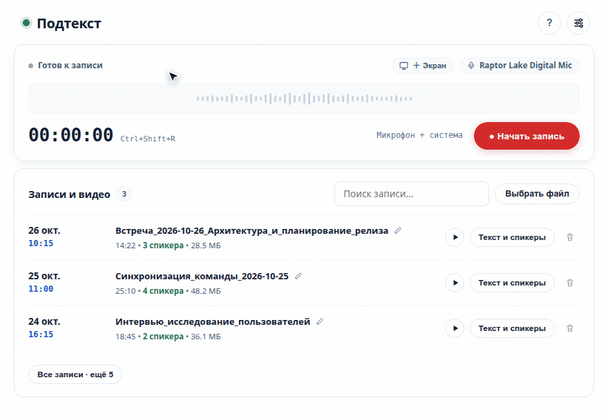
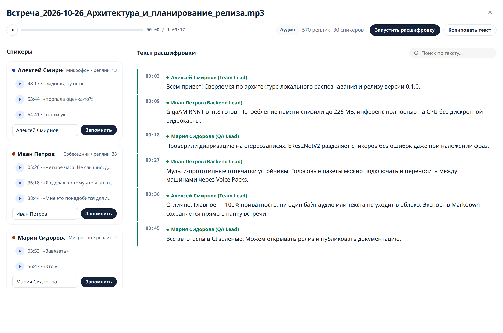
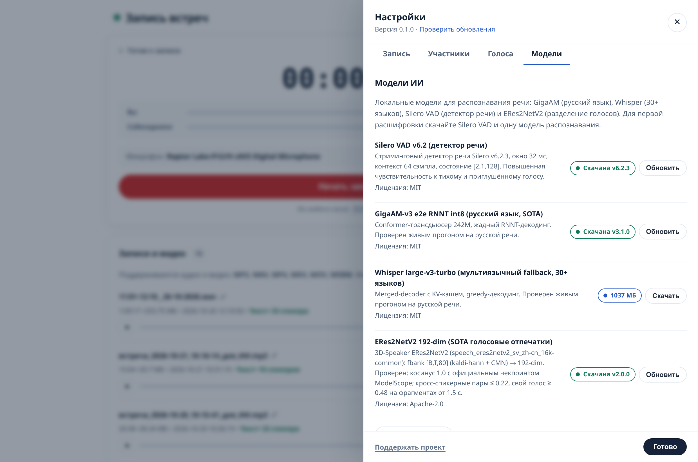

<div align="center">


# Запись встреч (Meeting Recorder)

**Локальная запись звонков и расшифровка речи на вашем компьютере.**  
Без облачных сервисов и платных подписок.

[](https://github.com/guest363/meeting-record/actions/workflows/ci.yml)
[](https://github.com/guest363/meeting-record/releases)
[](rust-toolchain.toml)
[](LICENSE)
[](#поддерживаемые-платформы)

---


<p><em>Запись в 1 клик, стерео-сплит собеседников, локальная расшифровка по спикерам и встроенный каталог моделей</em></p>

</div>

---

## Ключевые возможности

- **Раздельный захват:** На компьютере ваш микрофон пишется в левый канал, системный звук звонка — в правый (PipeWire / PulseAudio / WASAPI Loopback). Голоса не смешиваются в кашу, что повышает точность расшифровки и позволяет слушать собеседников отдельно.
- **100% офлайн и приватность:** Распознавание работает локально через ONNX Runtime прямо на процессоре ноутбука\телефона. Ни один байт аудио, текста или отпечатков голоса не отправляется во внешнюю сеть.
- **Русский язык SOTA (GigaAM-v3):** ИИ от SberDevices с квантованием весов в INT8 (всего 226 МБ). Распознает русскую речь быстро и без необходимости наличия дискретной видеокарты.
- **Мультиязычность (Whisper Turbo):** Встроенная модель Whisper large-v3-turbo (INT8, ~1.08 ГБ) для созвонов на английском и ещё 30+ языках.
- **Диаризация и узнавание коллег:** Модель ERes2NetV2 (3D-Speaker) разбивает дорожку на реплики и узнаёт знакомые голоса по сохранённым профилям (Voice Packs).
- **Готовые конспекты для базы знаний:** После остановки записи рядом с файлом автоматически создаются:
  - `.md` — читаемый протокол со спикерами и таймкодами (для Obsidian, Notion, Logseq);
  - `.txt` — чистый текст для отправки в локальные LLM;
  - `.transcript.json` — структурированные реплики, таймкоды и 192-мерные векторы голосов.

---

<div align="center">
  
  <p><em>Интерфейс расшифровки: таймкоды реплик, привязка голосов к участникам и экспорт в Markdown</em></p>
</div>

---

## Поддерживаемые платформы

| Платформа | Живой захват аудио | Импорт файлов и видео | Статус |
| :--- | :---: | :---: | :--- |
| **Linux** (PipeWire / PulseAudio) | Да (микрофон + система) | Да | Готов к работе |
| **macOS** (Apple Silicon, 13.4+) | В разработке (CoreAudio) | Да | Бета |
| **Windows** (10 / 11, x64) | В разработке (WASAPI) | Да | Бета |
| **Android** | Только микрофон | Аудио (без видео) | Экспериментально (см. [ANDROID.md](ANDROID.md)) |

> Готовые бинарные пакеты доступны на вкладке [Releases](https://github.com/guest363/meeting-record/releases).

---

## Быстрый старт

### Вариант 1. Готовые сборки
Скачайте бинарник для вашей ОС со страницы [Releases](https://github.com/guest363/meeting-record/releases):
- **Linux:** `.AppImage`
- **macOS:** `.dmg` (или запуск через `run.command`)
- **Windows:** `.exe` (или запуск через `run.bat`)

### Вариант 2. Запуск из исходников

```bash
git clone https://github.com/guest363/meeting-record.git
cd meeting-record
./run.sh
```

Приложение откроется в нативном окне. Для запуска в режиме веб-сервера без системных GUI-зависимостей (WebKit/GTK):

```bash
./run.sh --web
```

Консоль управления доступна в браузере по адресу `http://127.0.0.1:8765`.

### Системные требования

- **Процессор:** любой современный x86_64 или Apple Silicon.
- **Оперативная память:** от 1.5 ГБ RAM для GigaAM-v3; от 4 ГБ свободной RAM при расшифровке через Whisper.
- **Диск:** ~300 МБ для базовых моделей (Silero VAD + GigaAM + 3D-Speaker); ~1.4 ГБ с Whisper.
- **Linux:** Ubuntu 22.04+ / glibc 2.35+; для сборки нативного окна требуются системные библиотеки:
  ```bash
  sudo apt install libwebkit2gtk-4.1-dev libgtk-3-dev libayatana-appindicator3-dev librsvg2-dev
  ```
- **Поддержка форматов:** MP3, WAV, M4A, OGG, Opus, FLAC и MP4 декодируются нативно через библиотеку Symphonia. Для видеоконтейнеров MKV, WebM, MOV, AVI используется системный `ffmpeg` (если установлен).

---

## Локальный ИИ-конвейер

Обработка аудиопотока выполняется на 100% локально через **ONNX Runtime (CPU)** без дискретной видеокарты:

```
Аудиодорожка (16 кГц)
   │
   ▼
[Silero VAD v6] ──────────► Нарезка аудио на речевые фрагменты без пауз и шума
   │
   ├──────────────────────────────┬──────────────────────────────┐
   ▼                              ▼                              ▼
[GigaAM-v3 e2e RNNT]   [Whisper large-v3-turbo]        [ERes2NetV2 3D-Speaker]
(Основной ASR, RU, 226 МБ) (30+ языков, INT8, 1.08 ГБ) (Голосовые векторы, 68 МБ)
   │                              │                              │
   └───────────────┬──────────────┘                              ▼
                   ▼                                  Венгерская кластеризация
            Текст реплик ───────────────────────────► Итоговый Markdown / JSON
```

### Характеристики используемых моделей

| Модель | Назначение | Архитектура и веса | Память (RAM) | Особенности | Лицензия |
| :--- | :--- | :--- | :---: | :--- | :---: |
| **GigaAM-v3 e2e RNNT** | Основной ASR (RU) | Conformer-Transducer 242M, **INT8** (226 МБ) | ~600 МБ | SOTA для русской речи, жадный RNNT-декодинг | MIT |
| **Whisper Turbo** | Мультиязычный ASR | Seq2Seq Transformer, **INT8** (1.08 ГБ) | ~3.8 ГБ | 30+ языков, сжатый 4-слойный декодер | MIT |
| **Silero VAD v6.2** | Детектор речи | Потоковая рекуррентная сеть (2.3 МБ) | ~15 МБ | Окно 32 мс, фильтрация вздохов, кликов и эха | MIT |
| **ERes2NetV2 3D-Speaker** | Отпечатки голоса | ERes2NetV2 17.9M, FP32 (68 МБ) | ~120 МБ | 192-мерные L2-векторы, точность на отрезках от 1.5 с | Apache-2.0 |

<div align="center">
  
  <p><em>Менеджер моделей: проверка SHA-256 и докачка при обрыве</em></p>
</div>

<details>
<summary><strong>Подробнее об обновлении моделей и голосовых пакетах</strong></summary>

1. **Манифест моделей (`models-manifest.json`):** Версии файлов, официальные зеркала (HuggingFace / ModelScope) и контрольные суммы SHA-256 зафиксированы в коде приложения. При скачивании файл пишется во временный `.part` и подменяется атомарно только после совпадения контрольной суммы.
2. **Голосовые пакеты (Voice Packs):** Базы контактов и биометрических профилей хранятся независимо от кода в `<app_data>/packs/<id>/` (`people.json`, `voiceprints.json` v3, `snippets/*.wav`). Их можно экспортировать в `.voicepack.zip` и передавать коллегам.
3. **Совместимость версий (`embedding_space`):** При изменении архитектуры модели эмбеддингов старые несовместимые профили архивируются в резервную копию, предотвращая ошибки кластеризации.
</details>

---

## Управление и горячие клавиши

Глобальный хоткей (работает из любого окна):  
**`Ctrl+Shift+R`** (на macOS — **`Cmd+Shift+R`**) — начать или остановить запись.

### Команды CLI и автоматизация

```bash
./run.sh --toggle      # Переключить запись (удобно для привязки к системному хоткею)
./run.sh --start       # Начать запись
./run.sh --stop        # Остановить запись
./run.sh --tray        # Фоновый режим в системном трее
./run.sh --web         # Открыть веб-интерфейс в браузере

# Пакетная расшифровка аудиофайла без запуска интерфейса:
./run.sh --transcribe meeting.mp3 [--engine auto|gigaam|whisper]
```

---

## Приватность и безопасность

- **0 байт исходящего аудио:** все нейросети работают строго локально на вашем процессоре.
- **Отсутствие телеметрии:** приложение не собирает аналитику, логи использования или списки участников.
- **Сетевой трафик:** происходит только в двух случаях:
  1. Однократная загрузка открытых весов моделей с официальных репозиториев авторов (HuggingFace/ModelScope) по прямой команде пользователя.
  2. Проверка номера последнего релиза на GitHub при запуске (автоматическая установка обновлений отключена).

> **Внимание:** соблюдайте законы о конфиденциальности и предупреждайте собеседников о ведении записи разговора. Подробнее — в [PRIVACY.md](PRIVACY.md).

---

## Разработка и участие

Стек: **Rust** (MSRV 1.92, Tokio, Symphonia, Ort) + **Tauri v2** + **Svelte 5** (Vite, TypeScript).

```bash
# Запуск тестов ядра и математики диаризации
cargo test --workspace --locked --manifest-path src-tauri/Cargo.toml

# Проверка кода линтером (строгий режим без предупреждений)
cargo clippy --workspace --all-targets --locked --manifest-path src-tauri/Cargo.toml -- -D warnings

# Проверка типов и сборка фронтенда
cd ui/web/frontend && yarn install --immutable && yarn check && yarn build
```

Подробное описание архитектуры, внутренних крейтов и правил разработки находится в [AGENTS.md](AGENTS.md). Правила участия в разработке — в [CONTRIBUTING.md](CONTRIBUTING.md).

---

## Документация и ссылки

- [ANDROID.md](ANDROID.md) — сборка и ограничения мобильной версии;
- [docs/RELEASING.md](docs/RELEASING.md) — релизный цикл и публикация версий;
- [PRIVACY.md](PRIVACY.md) — политика конфиденциальности и локальности данных;
- [SECURITY.md](SECURITY.md) — сообщение об уязвимостях;
- [LICENSE](LICENSE) — лицензия MIT;
- [THIRD_PARTY_LICENSES.md](THIRD_PARTY_LICENSES.md) — лицензии сторонних библиотек и компонентов.

---

## Поддержка проекта

Разработка проекта ведётся на энтузиазме. Если приложение экономит ваше рабочее время:

- [Поддержать автора через Т-Банк](https://t.tb.ru/pm_short/8nsXmBmCIGj) (СБП / банковские карты)
- Поставьте звезду проекту на GitHub — это помогает развивать локальные ИИ-инструменты!
